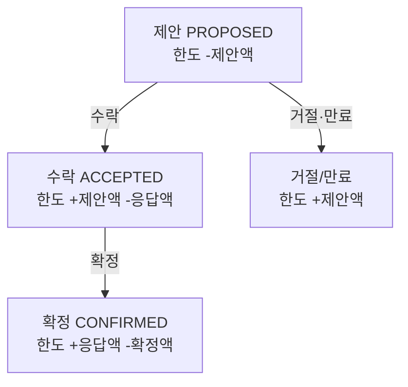

## 문제

기관 투자 연동에서, **같은 투자자에게 여러 딜이 동시에 제안**될 수 있다. 각 투자자에겐 한도가 있고, 한 딜의 제안 금액이 남은 한도를 넘으면 안 된다.

순진하게 "남은 한도를 확인하고 → 제안"으로 짜면 전형적인 경쟁 상태에 빠진다. 두 딜이 거의 동시에 남은 한도를 읽으면, 둘 다 "여유 있음"으로 판단하고 각자 제안해 **합계가 한도를 초과**한다.

```text
한도 100. 딜 A와 딜 B가 각각 70을 제안하려 한다.
A: 남은 한도 100 확인 → OK
B: 남은 한도 100 확인 → OK   (A의 제안이 아직 반영 전)
A: 70 제안
B: 70 제안
→ 합계 140. 한도 초과.
```

## 해결 — 제안 시점에 미리 차감하고, 나중에 정산한다

읽고 나서 쓰는 사이의 틈을 없애려면, **제안하는 순간 한도를 먼저 깎아 예약**하면 된다. 그리고 이후 상태 전이마다 정산한다.

- **제안(propose)**: 제안 금액만큼 한도를 **차감**한다. 이 순간 다른 딜은 줄어든 한도를 보게 되므로 이중 예약이 안 생긴다.
- **수락(accept)**: 투자자는 제안 금액 이하의 **실제 응답 금액**으로 답한다. 한도를 **제안 금액만큼 원복(예약 해제)** 하고, **응답 금액만큼 다시 차감**한다. 순효과는 "실제 응답분만 차감".
- **거절/만료(reject/expire)**: 제안 금액을 **전액 원복**한다. 예약만 잡고 아무것도 안 썼으니 되돌린다.
- **확정(confirm)**: 배분이 확정되면 응답분을 원복하고 최종 확정 금액만큼 다시 차감한다.



각 전이에서 "직전 예약을 풀고, 새 금액을 다시 잡는" 증감이 짝을 이룬다. 제안 시점에 미리 잡아두기 때문에, 여러 딜이 동시에 진행돼도 합계가 한도를 넘지 못한다.

## 이 패턴의 성질

이건 낙관적 예약(reserve-then-reconcile)이다. 전역 락으로 "한 번에 하나의 딜만 처리"하도록 직렬화하지 않고도 초과를 막는다. 예약이 곧 방어선이라, 동시성 처리량을 죽이지 않는다.

대신 **대가가 하나 있다. 모든 종료 경로에서 예약을 정확히 풀어야 한다.** 수락·거절·만료·오류 — 어느 경로로 끝나든 잡아둔 예약을 원복하지 않으면, 쓰이지도 않은 한도가 묶인 채 새어나간다(한도 누수). 정상 경로만 원복하고 예외 경로를 빠뜨리면, 시간이 지날수록 투자자의 가용 한도가 실제보다 작아진다.

그래서 이 구조를 쓸 때 설계의 무게 중심은 "어떻게 차감하나"가 아니라 **"모든 끝에서 빠짐없이 원복하나"** 에 있다. 상태 전이도를 그려놓고, 모든 종료 상태에서 예약이 0으로 정리되는지 하나씩 확인하는 게 핵심이다.

## 정리

동시에 여러 건이 같은 자원(한도)을 다툴 때, "확인 후 사용"은 경쟁 상태를 부른다. **제안 시점에 미리 차감해 예약하고, 상태 전이마다 정산**하면 전역 락 없이 초과를 막을 수 있다. 단, 예약은 반드시 모든 종료 경로에서 회수되어야 한다. 이 규칙 하나가 지켜지면 안전하고, 하나라도 새면 조용히 한도가 줄어든다.
