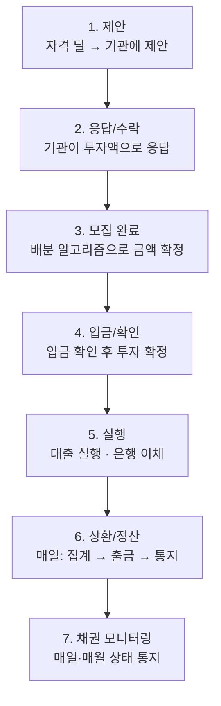

## 배경

사내 P2P 투자 플랫폼의 딜(대출 건)을 **외부 기관 투자자**에게 연결하는 연동을 다룬다. 딜이 자격을 갖추면 기관에 제안하고, 기관이 투자 금액으로 응답하면, 모집이 끝난 뒤 금액을 배분·확정하고, 대출을 실행한 다음, 매일 상환·정산하고 채권 상태를 모니터링한다.

세 주체가 있다.

- **사내 P2P 플랫폼** — 비즈니스 로직과 데이터 원본
- **중계 서버** — 제안 순회 루프, 배분 알고리즘, 기관과의 암호화 통신
- **외부 기관 투자자**

플랫폼과 기관 사이의 상태·프로토콜 차이를 중계 서버가 흡수한다.

## 라이프사이클

당일 처리(제안~실행)와 그 이후의 반복 처리(상환~모니터링)로 나뉜다.

### 제안 — 순환 루프

제안 단계는 **원형 연결 리스트**로 도는 루프로 구현돼 있다. 지역별로 진입 노드가 있고, 시작 노드부터 다음 노드로 순회하며 투자 비율과 잔여 한도를 반영해 제안 금액을 정한다. 여러 딜이 동시에 진행될 때 한도 초과를 막기 위해 **제안 시점에 투자자 한도를 미리 차감**하는데, 이 부분은 [별도 글](/posts/동시-진행-투자에서-한도-지키기-선차감-패턴/)에서 따로 다뤘다.

### 모집 완료 — 배분 알고리즘

모집이 끝나면 확정 금액을 투자자별로 나눈다. 단순 비례 배분으로는 응답 상한·최소 금액·단위 제약을 동시에 만족시킬 수 없어, 여러 단계를 거친다.

1. 유효 한도 비율로 **초기 배분**
2. 응답 상한을 넘는 몫을 잘라내고, 남은 몫을 나머지에 **재분배**(재귀)
3. 정해진 **금액 단위로 내림**
4. 최소 투자 금액 **보장**
5. 내림·보장으로 생긴 **잔돈을 채워** 합계를 맞춤

마감 조건에서 "확정 가능액 ≥ 배분 합계"가 항상 성립하도록 잡아, 배분이 초과되지 않게 한다.

### 상환/정산 — 3단계 상태 머신

상환은 매일 세 단계를 밟는다.

각 단계가 독립적으로 재시도 가능하도록 상태를 나눠, 은행 점검시간 같은 외부 제약에 걸려도 다음 스케줄에서 이어서 진행된다.

## 상태 전이

주체마다 별도의 상태 머신을 갖고, 서로의 전이가 이벤트로 연결된다.

- 플랫폼 딜: 모집중 → 마감 → 성공
- 중계 서버 딜: 진행 → 완료 → 실행
- 제안: 제안됨 → 수락 / 거절 / 만료
- 투자: 입금대기 → 입금완료 → 확정 → 실행

상태를 이렇게 잘게 나눈 이유는 **각 단계가 외부 시스템 응답을 기다리다 실패·지연될 수 있기 때문**이다. 한 흐름을 하나의 큰 트랜잭션으로 묶는 대신, 단계별 상태로 쪼개고 스케줄러가 각 상태를 주기적으로 진행시킨다. 어느 단계에서 멈춰도 그 상태에 남아 다음 주기에 재개된다.

## 정리

이 연동의 본질은 **"상태를 갖고, 여러 시스템에 걸쳐 있고, 외부 응답을 기다리는 흐름을 어떻게 신뢰성 있게 굴리나"** 였다. 답은 하나의 큰 트랜잭션이 아니라, 잘게 나눈 상태 머신 + 각 상태를 진행시키는 스케줄러 + 실패해도 되돌릴 수 있는 정산 구조였다. 제안의 한도 선차감, 배분의 다단계 조정, 상환의 3단계 분리 — 모두 같은 원칙의 다른 얼굴이다. 중간에 멈춰도 데이터가 붕 뜨지 않게 만드는 것.
