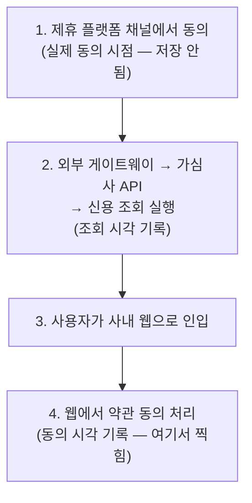

## 배경

신용 조회에는 컴플라이언스 규칙이 하나 있다. **사용자의 조회 동의 시각은 조회 실행 시각보다 앞서야 한다.** 동의를 받고 나서 조회하는 게 당연하니까.

그런데 실물 점검에서 이 순서가 뒤집힌 건이 나왔다. **동의 시각이 조회 시각보다 뒤에 찍혀 있었다.** 데이터상 "조회부터 하고 나중에 동의받은" 모양이 된 것이다. 실제로 그랬을 리는 없다. 어딘가에서 시각을 잘못 기록하고 있었다.

## 원인 — 동의는 한 곳에서, 기록은 다른 곳에서

동의와 조회가 **서로 다른 시스템에서 서로 다른 시점에** 일어나고 있었다.

사용자는 **제휴 플랫폼 채널**에서 이미 동의를 한다. 하지만 그 시점의 동의 시각은 사내로 전달·저장되지 않았다. 이후 가심사 흐름에서 신용 조회가 먼저 실행되어 조회 시각이 찍히고, 한참 뒤 사용자가 사내 웹으로 들어와 약관 동의를 처리할 때 **그제서야 동의 시각이 기록**됐다.

즉 사내가 기록한 "동의 시각"은 사실 **"사내가 동의를 처리한 시각"** 이었다. 실제 동의는 훨씬 앞(플랫폼 채널)에서 일어났는데, 그 시각을 버리고 나중 시점을 찍으니 조회보다 뒤로 밀린 것이다.

## 고친 방향

핵심은 **실제 동의가 일어난 곳의 시각을 그대로 실어 나르는 것**이다.

- 제휴 채널·외부 게이트웨이 쪽: 각 채널 명세에서 실제 동의 시각 필드를 확인하고, 사내로 전달하도록 수정.
- 사내 쪽: 전달받은 동의 시각을 저장. 이때 동의 이력을 시점별로 남길 수 있도록 저장 구조의 제약(유니크)도 함께 손봐야 했다.

동의 시각을 "우리가 처리한 시각"으로 만들어내지 않고, "사용자가 실제로 동의한 시각"을 받아서 쓰는 쪽으로 바꾼 것이다.

## 교훈

타임스탬프가 **순서 불변식**(A는 B보다 앞서야 한다)을 만족해야 하는데, A와 B가 **서로 다른 시스템에서 다른 순간에** 기록된다면, A를 "내 시스템이 그걸 처리한 시각"으로 유도하면 안 된다. 처리 시점은 실제 이벤트 시점과 얼마든지 어긋날 수 있기 때문이다.

이벤트의 진짜 시각은 **그 이벤트가 실제로 일어난 곳**에서만 알 수 있다. 그러니 순서가 중요한 시각은 발생 지점에서 캡처해 끝까지 실어 날라야 한다. "동의 시각"은 우리가 동의를 처리한 시각이 아니라, 사용자가 동의한 시각이다. 이 구분을 놓치면, 아무 코드도 틀리지 않았는데 데이터의 인과가 뒤집힌다.
