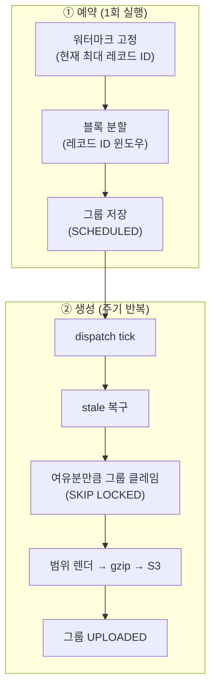
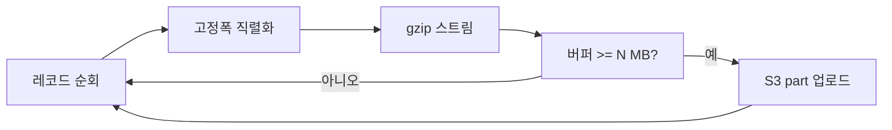

## 배경

사내에는 매일 신규 신용정보 전문(電文)을 외부 신용정보 기관으로 전송하는 파이프라인이 있다. 하루치 신청 레코드를 정해진 고정폭 포맷으로 직렬화해 파일로 만들고, 약속된 채널로 올린다.

이번에 새로 필요해진 건 **과거 적재분 전체를 소급해서 다시 만들어 보내는 것**이었다. 전송 포맷 규격이 새 레이아웃으로 바뀌면서, 이미 쌓여 있던 과거 데이터도 새 규격으로 재생성해야 했다. 규모는 수천만 건.

하루치를 도는 기존 파이프라인을 그대로 수천만 건 규모에 돌릴 수는 없다. 몇 가지 문제를 순서대로 풀어야 했다.

1. 수천만 건을 **무엇을 기준으로** 잘라 나눌 것인가 (파티셔닝 키)
2. 잘린 블록을 **어떻게 순회**할 것인가 (OFFSET vs keyset)
3. 여러 워커가 **겹치지 않게** 나눠 처리하는 법 (분산 클레임)
4. 중간에 죽어도 안전한 **멱등 생성**과 부분 실패 가시화
5. 블록당 수 GB 파일을 **메모리를 터뜨리지 않고** 올리는 법

## 전체 구조

2단계로 나눴다. 예약(schedule) 단계에서 전체 범위를 블록으로 쪼개 DB에 그룹으로 적재하고, 생성(generate) 단계에서 워커들이 그룹을 하나씩 집어 파일을 만든다.



예약을 한 번 돌려 그룹을 다 만들어 두고, 생성 태스크를 주기적으로 돌리면 전체가 끝날 때까지 자동으로 흘러간다. 소급은 일회성이라 별도의 실행 커맨드를 만들기보다, 기존 스케줄러에 생성 태스크를 등록하는 쪽을 택했다.

## 문제 1. 파티셔닝 키 — 신청 ID로 나누면 안 된다

처음엔 자연스럽게 **신청 ID** 범위로 블록을 잘랐다. 신청 레코드마다 auto-increment PK가 있으니 `1 ~ N`, `N+1 ~ 2N` … 이렇게 나누면 될 것 같았다.

그런데 실제 대상 수를 세어 보니 예상보다 몇 배 컸다. 원인은 **신청 ID가 글로벌 시퀀스**라는 데 있었다.

전송 대상은 "실제로 적재된 레코드"인데, 신청 ID는 적재 여부와 무관하게 계속 증가한다. 즉 적재된 레코드들 사이사이에 **적재되지 않은 신청이 잔뜩 끼어 있다.** 신청 ID 범위로 긁으면 이 미적재분까지 후보로 딸려 들어와, 실제 대상보다 훨씬 많은 수를 잡게 된다.

```text
신청 ID:   1   2   3   4   5   6   7   8  ...
적재 여부:  O   .   .   O   O   .   .   O
                ↑ 신청 ID 범위로 자르면 이 빈칸까지 후보에 포함
```

키를 바꿨다. 전송 대상은 **적재 이력 레코드**로 관리되는데, 이 레코드는 append-only다 — 정상 운영에서 신청당 1회 생성되고 수정·삭제되지 않는다. 즉 **적재 이력 레코드의 ID가 안정적인 스냅샷 키**다. 이 ID로 윈도잉하면 빈칸 없이 실제 대상만 정확히 잘린다.

파티셔닝 키를 신청 ID에서 적재 이력 ID로 바꾼 것만으로 과다선정 문제가 사라졌고, 실제 대상 수가 정확히 잡혔다.

교훈: **범위 분할의 키는 "무엇을 세고 싶은가"와 정확히 일치하는 안정적 시퀀스여야 한다.** 글로벌 auto-increment PK는 "그 테이블에 행이 있다"는 사실을 셀 뿐, "하위 조건을 만족하는 대상"을 세지 않는다.

## 문제 2. 대량 순회 — OFFSET을 쓰지 않는다

블록 분할과 블록 내 순회 모두 **keyset(seek) 방식**을 썼다. `LIMIT/OFFSET`은 뒤로 갈수록 앞의 행을 매번 스캔해 버리고 지나가므로, 수천만 건 뒤쪽 블록에서 급격히 느려진다.

대신 마지막으로 처리한 ID를 기억하고 그 다음부터 읽는다.

```sql
-- OFFSET 방식 (뒤로 갈수록 느려짐)
SELECT id FROM record_info ORDER BY id LIMIT 400000 OFFSET 40000000;

-- keyset 방식 (블록 위치와 무관하게 일정한 속도)
SELECT id FROM record_info
WHERE id > :last_seen_id
ORDER BY id
LIMIT 400000;
```

PK 인덱스를 그대로 타므로 블록이 몇 번째든 비용이 일정하다. 예약 단계에서 이 방식으로 전체를 고정 크기(수십만 건) 블록으로 나눠, 그룹 레코드에 `start_id`, `end_id`로 저장했다.

## 문제 3. 분산 생성 — SKIP LOCKED로 겹치지 않게 집기

블록이 많으니 워커 여러 개가 병렬로 처리하면 좋다. 문제는 **같은 그룹을 두 워커가 동시에 집지 않게** 하는 것.

`SELECT ... FOR UPDATE SKIP LOCKED`를 쓰면 깔끔하다. 한 워커가 그룹을 집어 잠그면, 다른 워커는 그 행을 **기다리지 않고 건너뛰어** 다음 미처리 그룹을 집는다.

```sql
SELECT id FROM record_group
WHERE status = 'SCHEDULED'
ORDER BY id
LIMIT 1
FOR UPDATE SKIP LOCKED;
```

집은 즉시 상태를 GENERATING으로 바꾸고 claim 시각을 찍는다. dispatch 태스크는 매 tick마다 "지금 GENERATING인 그룹 수 < 최대 동시 실행 수"인 만큼만 새로 발행해, 동시 처리량을 상한선 안에서 유지한다.

**stale 복구**도 붙였다. 워커가 파일을 만들다 죽으면 그룹이 GENERATING인 채로 남는다. dispatch가 매번 "claim 시각이 임계값보다 오래된 GENERATING 그룹"을 SCHEDULED로 되돌려 재처리 대상에 넣는다. 죽은 워커의 작업이 영원히 붕 뜨지 않도록.

## 문제 4. 멱등 생성과 부분 실패 가시화

같은 그룹이 재처리될 수 있으니(stale 복구, 수기 리트라이) **생성은 멱등이어야 한다.**

- 파일은 S3의 **같은 키에 덮어쓴다.** 재실행하면 이전 파일을 그대로 대체한다.
- 그룹의 이전 실패 기록을 execute 시작 시 지운다. 이전 실행의 잔여 실패가 이번 결과에 섞이지 않도록.

**부분 실패를 삼키지 않는 것**도 중요했다. 수천만 건을 도는 동안 개별 레코드 렌더가 실패할 수 있다. 이걸 조용히 건너뛰고 전체를 DONE으로 마감하면, "다 됐다"는 상태 자체가 거짓이 된다.

- 개별 레코드 렌더 실패는 실패 기록에 남기고, 그 레코드만 파일에서 빼고 계속 간다.
- 단, 그룹 중 하나라도 FAILED면 전체 회차를 DONE이 아니라 **FAILED로 마감**한다. 복구는 FAILED 그룹만 다시 SCHEDULED로 되돌려 재실행 — 멱등이라 안전하다.

"완료" 상태는 **정말 완료됐을 때만** 붙어야 한다. 이게 안 지켜지면 누락을 영영 모른다.

## 문제 5. 수 GB 파일 스트리밍 업로드

블록당 수십만 건이면 파일이 수 GB다. 이걸 메모리에 다 담아 만들고 올리면 워커가 터진다.

**gzip 스트리밍 + S3 Multipart Upload**로 상수 메모리를 유지했다. 레코드를 직렬화하며 gzip 스트림에 흘려보내고, 버퍼가 일정 크기(수 MB)를 넘으면 그 조각을 Multipart part로 올린다. 전체 파일이 아니라 조각 하나만 메모리에 있으면 된다.



주의할 점 몇 가지.

- Multipart는 part 수 상한(10,000)이 있어, part 크기를 너무 작게 잡으면 대용량에서 상한에 걸린다. 최소 part 크기를 충분히 잡아야 한다.
- 중간 실패 시 **업로드를 abort**해 반쯤 올라간 조각을 정리한다 (context manager로 처리).

## 정리

특별한 기술을 쓴 건 없다. keyset 순회, SKIP LOCKED 클레임, 멱등 재실행, 스트리밍 업로드 — 각각은 익숙한 도구다. 어려웠던 건 **문제 1**, 파티셔닝 키였다. "무엇을 세고 싶은가"와 키가 어긋나 있으면, 나머지 설계가 아무리 정교해도 처음부터 몇 배 많은 대상을 붙잡고 있게 된다.

대용량 배치를 설계할 때 제일 먼저 물어야 할 질문은 "어떻게 빠르게 돌릴까"가 아니라 **"내가 지금 세고 있는 게 정말 대상이 맞나"**였다.
