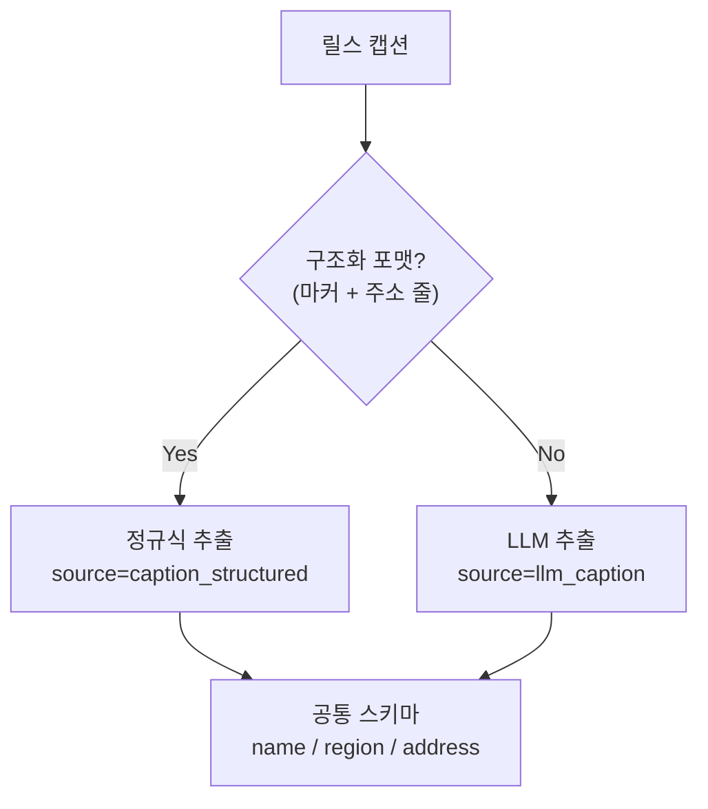

## 문제

인스타그램 릴스 캡션에서 맛집 정보를 뽑아 지도로 만드는 개인 프로젝트를 하고 있다. 입력은 크리에이터가 쓴 자유 서술형 텍스트다.

어떤 캡션은 친절하다.

```text
📍뚝딱 문래
▪️서울 영등포구 도림로 431 1층
⏰ 평일 11:00~22:00
```

핀 마커(📍) 뒤에 가게명, 다음 줄에 주소. 규칙이 뚜렷하니 정규식으로 잡힌다.

그런데 어떤 캡션은 이렇다.

```text
FWV는 분위기 좋은 테라스와 정통 이탈리안 메뉴로
사랑받는 용산의 인기 맛집이에요
```

가게명(FWV)과 지역(용산)이 문장 안에 녹아 있다. 정규식으로는 못 잡는다. "인기", "분위기" 같은 단어와 가게명을 구분할 규칙을 짤 수가 없다.

두 종류의 입력을 **하나의 출력 스키마**로 통일해야 한다.

---

## 결론부터: 전부 LLM에 맡기지 않는다

처음 떠오르는 답은 "그냥 전부 LLM에 넣자"다. 하지만 그건 낭비다. 규칙으로 풀 수 있는 입력까지 토큰을 쓸 이유가 없고, 결정론적으로 풀리는 걸 비결정적 경로로 보내면 디버깅도 어려워진다.

그래서 **싼 결정론 경로를 먼저 태우고, 거기서 빠진 것만 LLM으로 메우는** 2단 구조로 갔다.



정규식 경로(`extract.py`)와 LLM 경로(`extract_llm.py`)가 **같은 모양의 dict**를 뱉는다. 뒷단 파이프라인은 어느 경로에서 왔는지 `source` 필드로만 구분하고, 나머지 처리는 동일하게 받는다.

---

## LLM 경로: json_schema로 출력을 고정한다

LLM을 비정형 텍스트 파서로 쓸 때 가장 중요한 건 "출력이 항상 같은 모양이어야 한다"는 점이다. 프롬프트로 "JSON으로 답해줘"라고 부탁하는 방식은 가끔 설명 문장을 앞에 붙이거나 필드를 빠뜨린다. 그 가끔이 파이프라인을 깨뜨린다.

그래서 스키마를 요청 자체에 박아 강제한다.

```python
SCHEMA = {
    "type": "object",
    "properties": {
        "places": {
            "type": "array",
            "items": {
                "type": "object",
                "properties": {
                    "name": {"type": "string", "description": "가게 이름"},
                    "region": {"type": "string", "description": "지역 힌트. 없으면 빈 문자열"},
                    "address": {"type": "string", "description": "캡션에 명시된 주소. 없으면 빈 문자열"},
                },
                "required": ["name", "region", "address"],
                "additionalProperties": False,
            },
        }
    },
    "required": ["places"],
    "additionalProperties": False,
}

params = {
    "model": MODEL,
    "max_tokens": 2048,
    "system": SYSTEM,
    "output_config": {"format": {"type": "json_schema", "schema": SCHEMA}},
    "messages": [{"role": "user", "content": f"[캡션]\n{caption}\n\n[해시태그]\n{tags}"}],
}
resp = client.messages.create(**params)
```

`additionalProperties: False`와 `required`를 걸어두면 모델이 임의 필드를 끼워 넣거나 필드를 생략할 수 없다. 받는 쪽에서 `json.loads(text)["places"]`를 바로 신뢰할 수 있다. 파싱 방어 코드가 사라진다.

---

## 비정형 추출의 진짜 적: 지어내기

스키마는 "모양"을 보장할 뿐 "내용"을 보장하지 않는다. 비정형 텍스트 추출에서 가장 위험한 실패는 **모델이 없는 정보를 채우는 것**이다. 주소가 안 적혀 있는데 그럴듯한 주소를 지어내면, 그건 틀린 데이터가 조용히 들어오는 것이라 빈 값보다 나쁘다.

그래서 시스템 프롬프트에서 "모르면 비운다"를 반복해서 못 박았다.

```text
- address는 캡션에 도로명/지번 주소가 명시적으로 적혀 있을 때만 채운다. 추측 금지.
- 홍보 문구, 해시태그성 단어(맛집추천, 저장필수, 데이트코스), 메뉴명,
  브랜드 일반명은 가게 이름이 아니다. 제외한다.
- 가게를 특정할 수 없으면 빈 배열을 반환한다. 지어내지 않는다.
```

여기에 더해, 모델이 요청을 거절하는 경우(`stop_reason == "refusal"`)도 명시적으로 빈 결과로 처리한다. "실패하면 빈 배열"을 모든 분기의 기본값으로 둔다.

```python
if resp.stop_reason == "refusal":
    return []

text = next((b.text for b in resp.content if b.type == "text"), "")
if not text:
    return []
```

**비어 있는 결과는 다음 단계에서 처리할 수 있다. 틀린 결과는 처리할 수 없다.** 이 원칙이 추출기 전체의 기본값을 정했다.

---

## 비용: 작업에 맞는 모델을 고른다

캡션에서 상호명을 찾는 건 추론 난이도가 낮고, 출력도 50토큰 안팎으로 짧다. 이런 작업에 가장 비싼 모델을 쓸 이유가 없다.

같은 269건을 두 모델로 돌려 실측한 비용 차이는 분명했다.

| 모델 | 269건 추출 비용 | 용도 |
|------|----------------|------|
| 상위 모델 (Opus급) | $2.08 | 품질이 부족할 때만 |
| 경량 모델 (Haiku급) | $0.42 | 기본값 |

약 5배 차이다. 건수가 늘수록 이 차이는 선형으로 커진다. 그래서 경량 모델을 기본으로 두되, 품질이 아쉬운 특정 크리에이터는 환경변수로 상위 모델로 올릴 수 있게 열어뒀다.

```python
MODEL = os.getenv("REELMAP_EXTRACT_MODEL", "claude-haiku-4-5")

# 경량 모델은 일부 고급 요청 파라미터(adaptive thinking, effort)를 받지 않는다.
# 모델 세대에 따라 파라미터를 자동으로 붙였다 뗀다.
_MODERN = not MODEL.startswith(("claude-haiku-4-5", "claude-sonnet-4-5"))

if _MODERN:
    params["thinking"] = {"type": "adaptive"}
    params["output_config"]["effort"] = "low"
```

여기서 걸린 함정 하나: 경량 모델에 상위 모델 전용 파라미터를 그대로 보내면 400 에러가 난다. 모델을 설정으로 바꿀 수 있게 만들려면, 모델에 따라 **요청 파라미터도 함께 갈라져야** 한다. 모델 교체를 설정 한 줄로 끝내려면 그 분기를 코드가 흡수해줘야 한다.

---

## 느낀 점

### LLM은 "마지막 수단"으로 쓸 때 가장 강하다
정규식으로 풀리는 입력까지 LLM에 넣으면 비싸고 느리고 비결정적이다. 결정론 경로가 처리 못 한 꼬리(tail)만 LLM이 맡으면, 전체 비용은 낮게 유지되면서 커버리지는 올라간다. "LLM이냐 규칙이냐"가 아니라 "규칙 먼저, 나머지만 LLM"이다.

### 출력 모양은 스키마로, 출력 내용은 프롬프트로
json_schema는 필드 구조를 보장하지만 "지어내지 않기"는 보장하지 않는다. 구조는 스키마에, 사실성은 시스템 프롬프트의 명시적 규칙에 맡겨야 한다. 두 축이 다르다.

### 기본값을 "빈 결과"로 두면 파이프라인이 안전해진다
오류, 거절, 빈 응답, 특정 불가 — 모든 실패 분기를 빈 배열로 수렴시키면, 추출기는 "틀린 데이터를 넣지 않는다"는 성질을 얻는다. 뒷단은 빈 결과만 다루면 되니 단순해진다.

### 모델을 설정으로 바꾸려면 파라미터 분기까지 설계해야 한다
"환경변수로 모델 교체"는 모델 ID만 바꾼다고 끝나지 않는다. 세대별로 허용되는 요청 파라미터가 달라서, 그 차이를 코드가 자동으로 흡수해야 진짜로 설정 한 줄 교체가 된다.
