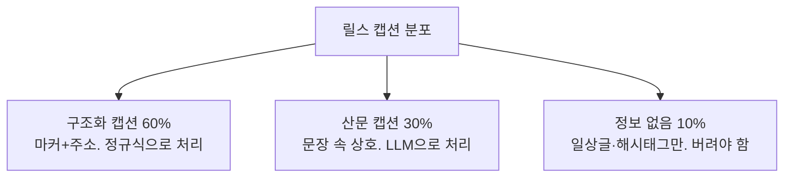
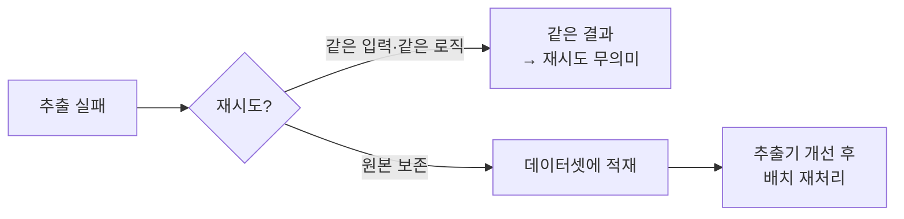

## 이 글의 전제

예전에 [LLM 평가 파이프라인 설계](/posts/llm-평가-파이프라인-설계-프롬프트를-어떻게-테스트하는가/) 글에서 "평가 데이터셋을 만들고, LLM-as-Judge로 점수 매기고, A/B로 회귀를 잡는다"는 정석을 정리했다.

그런데 그 정석에는 전제가 있다. **정답셋이 있다는 전제.** 50~100개의 "입력 + 기대 출력" 쌍을 누군가 미리 만들어뒀다는 것.

개인 프로젝트에서 인스타 릴스 캡션에서 맛집을 추출하는 기능을 만들면서, 그 전제가 없을 때 뭘 할 수 있는지 부딪혔다. 정답셋을 만들 사람은 나 하나고, 입력(크리에이터 캡션)은 포맷이 제각각이라 "기대 출력"을 미리 정의하기도 어렵다.

이 글은 그 현실판 기록이다. **정답셋을 못 만들 때, 추출기를 어떻게 조금씩 신뢰하게 되는가.**

---

## 분포를 증명한다는 것

추출기 하나를 "된다"고 말하려면, 한 케이스가 아니라 **입력 분포 전체에서 된다**를 보여야 한다. 내 캡션 입력은 대략 세 덩어리로 나뉜다.



문제는 이 세 덩어리가 각각 다른 방식으로 실패한다는 것이다. 그래서 하나의 종합 점수로 뭉개면 안 되고, **덩어리별로 다른 안전장치**가 필요했다.

---

## 안전장치 1: 실패에서 역산한 회귀 테스트

정답셋이 없어도, **실제로 터진 실패**는 있다. 그게 가장 정직한 테스트 재료다.

초기에 정규식이 핀 마커(📍)를 가정하지 않고 번호 마커(1️⃣)만 가정하고 있었다. 그 결과 주 추출 경로가 통째로 죽고, 전부 해시태그 폴백으로 떨어졌다. 그래서 `#mbti`, `#난널버리지않아` 같은 해시태그가 "맛집"으로 등록됐다.

이 실패를 그대로 테스트로 박았다.

```python
def test_핀_마커_캡션에서_이름과_주소를_뽑는다():
    caption = (
        "📍뚝딱 문래\n"
        "▪️서울 영등포구 도림로 431 1층\n"
    )
    places = extract_places_from_caption(caption, ["문래동맛집"])
    assert places[0]["name"] == "뚝딱 문래"
    assert places[0]["source"] == "caption_structured"


def test_해시태그_폴백은_구조화로_승격되지_않는다():
    """일상글 유형. 이 출처는 자동 등록하지 않고 검수로 보낸다."""
    caption = "행복한 하루였다"
    hashtags = ["부부스타그램", "mbti", "난널버리지않아"]
    places = extract_places_from_caption(caption, hashtags)
    assert all(p.get("source") != "caption_structured" for p in places)
```

여기엔 유니코드 함정도 있었다. 흰색 불릿 `▫️`(U+25AB)는 검은색 불릿 `▪️`(U+25AA)와 **다른 문자**다. 초기 정규식이 하나만 넣어서 절반을 놓쳤다. 이것도 테스트로 고정했다.

정답셋은 못 만들어도, **터진 것마다 테스트로 박으면** 시간이 갈수록 분포의 커버리지가 쌓인다. 완전하진 않지만, "같은 실수를 두 번 하지 않는다"는 보장은 생긴다.

---

## 안전장치 2: 출처(source)로 신뢰 등급을 나눈다

정답셋이 없으니 "이 추출이 맞다"를 판정할 수 없다. 대신 **"이 추출을 얼마나 믿을지"를 출처로 등급화**했다.

| source | 근거 | 처리 |
|--------|------|------|
| `caption_structured` | 주소가 캡션에 명시됨 | 자동 등록 |
| `llm_caption` | LLM이 문장에서 추출 | 교차검증 후 등록 |
| 해시태그 폴백 | 태그에만 등장 | 자동 등록 안 함, 검수행 |

핵심 규칙은 하나다. **신뢰의 근거가 "주소가 명시됐다"는 사실.**

```python
def test_주소가_없으면_구조화_추출로_보지_않는다():
    """구조화 추출은 '주소가 명시됐다'가 신뢰의 근거다. 없으면 폴백으로 간다."""
    caption = "오늘은 여기! 진짜 맛있었어요\n📍어딘가\n▪️영업시간 11시\n"
    places = extract_places_from_caption(caption, ["맛집추천"])
    assert all(p.get("source") != "caption_structured" for p in places)
```

마커는 있지만 주소 줄이 영업시간이면, 구조화로 인정하지 않는다. 정답을 모르니 **근거가 약한 추출은 자동화하지 않고 사람 검수로 보낸다.** 틀릴 위험이 높은 것을 자동 반영에서 빼는 것, 이게 정답셋 없이 할 수 있는 품질 관리다.

---

## 안전장치 3: 자기일관성으로 재처리 금지

LLM 추출이 실패했을 때, 재시도는 하지 않기로 했다.



같은 캡션에 같은 추출 로직이면 결과도 같다. 즉석에서 다시 돌려봐야 토큰만 쓴다. 대신 **실패한 원본을 그대로 쌓아두고**, 나중에 추출기를 고친 다음 모아서 재처리한다. 실패 자체가 다음 버전의 정답셋 후보가 된다. 정답셋이 없어서 시작했는데, 실패 로그가 정답셋의 씨앗이 되는 구조다.

---

## 아직 못 한 것: LLM 경로의 평가

정직하게 적자면, 여기엔 큰 구멍이 있다.

정규식 경로는 회귀 테스트로 꽤 촘촘히 덮었지만, **LLM 경로(`llm_caption`)에는 아직 정식 평가가 없다.** "산문 캡션에서 상호를 얼마나 정확히 뽑는가"를 측정하는 정답셋도, LLM-as-Judge 하네스도 안 붙였다. 지금은 외부 교차검증(지도 API 조회가 되는가)으로 사후에 거르는 게 전부다.

이게 이 프로젝트의 현재 한계다. 규모가 커지면 결국 정석으로 돌아가 — LLM 경로용 정답셋을 만들고 judge를 붙여야 한다. 지금은 "실패에서 역산한 회귀 테스트 + 출처 등급화 + 재처리 금지"로 버티는 단계다.

---

## 느낀 점

### 정답셋이 없어도 "실패셋"은 있다
완벽한 기대 출력을 미리 정의 못 해도, 실제로 터진 오류는 가장 신뢰할 수 있는 테스트 재료다. 터질 때마다 테스트로 박으면 분포 커버리지가 바닥부터 쌓인다. 정답을 모르는 채로도 회귀는 막을 수 있다.

### 신뢰할 수 없으면 자동화하지 않는다
판정할 정답이 없을 때의 품질 관리는 "맞는 것만 통과"가 아니라 "근거 약한 것은 자동 반영에서 제외"다. 자동화 범위를 신뢰 등급으로 좁히는 것 자체가 평가의 한 형태다.

### 실패 로그가 다음 정답셋이 된다
재시도 대신 원본을 보존하면, 실패 데이터가 쌓여 나중의 평가셋·재처리 재료가 된다. "정답셋이 없어서 못 한다"가 "실패를 모아 정답셋을 만든다"로 뒤집힌다.

### 평가의 공백을 숨기지 않는다
LLM 경로에 정식 평가가 없다는 건 분명한 한계다. 어디까지 검증됐고 어디가 공백인지를 스스로 아는 것이, 공백을 가린 채 "잘 된다"고 말하는 것보다 안전하다.
