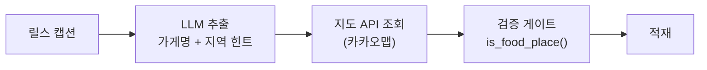
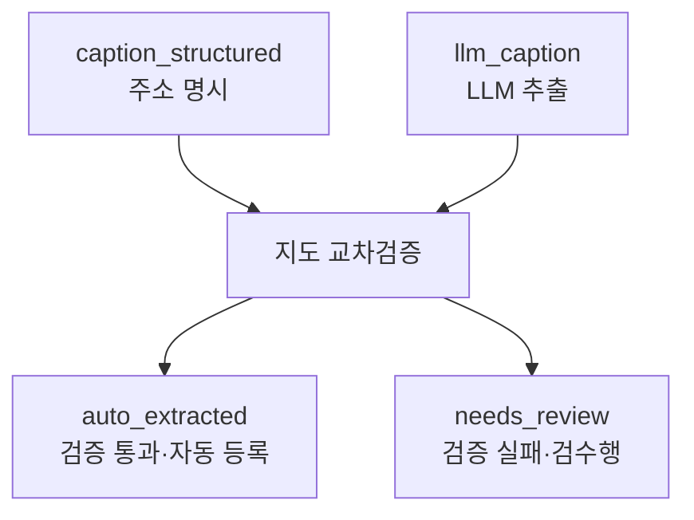

## grounding이란 무엇인가

RAG(Retrieval-Augmented Generation)의 핵심은 "모델이 아는 것"이 아니라 "검색해온 문서"에 답을 묶는 것이다. 이걸 grounding이라 부른다. 답변마다 `[출처: ...]`를 붙이고, 그 출처에 실제로 근거가 있는지 검증하는 흐름이다.

RAG 문맥에서 grounding은 보통 "텍스트 → 텍스트" 검증이다. 생성된 문장이 원본 문단에 실제로 있는 내용인가.

그런데 grounding의 본질은 더 넓다. **"LLM이 만든 출력을, 모델 바깥의 신뢰할 수 있는 권위에 대조해 참을 보증하는 것."** 출처가 문서일 수도, 데이터베이스일 수도, 외부 API일 수도 있다.

개인 프로젝트(릴스 캡션 → 맛집 지도)에서 이걸 "텍스트 → 지도 API" 형태로 구현하면서 배운 걸 정리한다. 형태는 RAG와 달라도, "모델을 믿지 않고 바깥에 대조한다"는 원리는 같다.

---

## 문제: LLM은 그럴듯한 가게를 지어낸다

파이프라인은 이렇게 생겼다.



LLM은 캡션에서 "FWV, 용산" 같은 후보를 뽑는다. 하지만 이건 **후보**일 뿐이다. 그 이름이 실존하는 음식점인지, 지도 위 어디인지는 LLM이 모른다(알더라도 믿으면 안 된다). 그래서 지도 API라는 외부 권위에 대조한다.

여기서부터가 진짜 grounding 설계다.

---

## 원칙 1: 검증 모듈은 판정하지 않는다

처음엔 지도 검색 루프 안에서 "이건 맛집 아니네" 하고 걸러냈다. 그게 오염을 낳았다.

`홍대걷고싶은거리`(테마거리)를 검색 결과에서 거른 뒤, 루프가 **다음 결과**를 집어서 근처 투썸플레이스를 갖다 붙였다. 캡션엔 없던 가게가 조용히 등록된 것이다.

문제의 핵심은 **거부(reject)와 대체(substitute)를 섞은 것**이었다.

```text
거부: "이 후보는 맛집이 아니다" → 버린다
대체: "이 후보 대신 다른 걸 쓴다" → 캡션에 없던 데이터 생성
```

grounding에서 필요한 건 거부지 대체가 아니다. 대조에 실패하면 **버려야지, 비슷한 걸로 메우면 안 된다.** 그래서 검색 모듈은 "카카오가 준 최상위 결과를 그대로 반환"만 하고, 맛집 판정은 적재 직전 단 한 곳에서만 하도록 책임을 분리했다.

```python
"""Geocoding 모듈 - 카카오맵 API로 좌표 + 카테고리 변환

설계 원칙: 이 모듈은 판정하지 않는다. 카카오가 준 최상위 결과를
그대로 반환하고, 맛집인지 아닌지는 적재 직전에 is_food_place()로
한 번만 판정한다.
"""
```

---

## 원칙 2: 검증은 단일 게이트에서

grounding 검증 로직이 여러 곳에 흩어지면, 어떤 경로는 검증을 건너뛰게 된다. 그래서 "적재해도 되는가"를 묻는 게이트를 하나로 모았다.

```python
def is_food_place(geo: dict, address_verified: bool = False) -> bool:
    """적재해도 되는 맛집인지 판정하는 단일 게이트."""
    ...

# 파이프라인에서의 호출 — 적재 직전 단 한 번
geo = geocode_place(name=cand["name"], address=cand.get("address"), region=cand.get("region", ""))
if not geo:
    continue
if not is_food_place(geo, address_verified=bool(cand.get("address"))):
    rejected += 1
    continue
place = upsert_place(db, geo, fallback_name=cand["name"])
```

지도 API 카테고리 코드만으로는 안 걸러진다. 카카오는 만화카페를 '카페(CE7)'로 분류하고, 주소 기반 검색이 가끔 옷가게·구두매장을 물어온다. 그래서 그룹 코드 + 차단 카테고리 키워드를 함께 본다.

```python
BLOCKED_CATEGORY_KEYWORDS = (
    "여가시설",   # 만화방/PC방
    "숙박",       # 호텔 (안에 식당이 있어도 호텔은 맛집이 아님)
    "패션",       # 의류/구두
    "관광,명소",  # 테마파크, 테마거리
    ...
)
```

이 게이트가 **외부 권위(지도 분류)를 우리 도메인 규칙으로 한 번 더 거르는** grounding의 마지막 단계다.

---

## 원칙 3: 근거의 강도에 따라 검증을 완화한다

모든 후보를 똑같이 의심하진 않는다. **크리에이터가 캡션에 주소를 직접 적었다면**, 그건 LLM 추측보다 강한 근거다. 이 경우엔 카테고리 판정을 완화한다.

```python
def is_food_place(geo, address_verified=False):
    # address_verified=True는 크리에이터가 캡션에 주소를 직접 적은 경우.
    # 이때는 카테고리가 음식점이 아니어도 통과시킨다 —
    # 백반집으로 운영되는 '종점슈퍼'(가정,생활>슈퍼마켓)처럼
    # 지도 분류가 실제 영업 형태와 어긋나는 경우가 있다.
```

지도 API조차 틀릴 때가 있다. '종점슈퍼'는 분류상 슈퍼마켓이지만 실제로는 백반집이다. 외부 권위가 절대적이지 않으므로, **더 강한 근거(명시된 주소)가 있으면 약한 권위(자동 분류)를 덮어쓸 수 있게** 우선순위를 뒀다.

grounding은 "외부 소스를 맹신"이 아니다. **근거들 사이의 우선순위를 정하는 일**이다.

---

## 원칙 4: 출처를 데이터에 남긴다

최종 적재 데이터에는 이 핀이 어떤 경로로 들어왔는지 `source`가 남는다.

```python
link_mention(db, place, reel, creator, source="auto_extracted")
```



나중에 "이 가게 왜 여기 있지?"를 추적할 수 있어야 한다. provenance가 없으면 틀린 데이터를 발견해도 원인을 되짚을 수 없다. RAG의 `[출처:]` 인용과 같은 역할을, 데이터 레코드 수준에서 하는 것이다.

---

## 느낀 점

### grounding은 RAG만의 것이 아니다
"LLM 출력을 모델 바깥 권위에 대조한다"는 원리는 문서 검색이든 지도 API든 DB 조회든 동일하다. 형태(텍스트↔텍스트)에 갇히지 말고 원리(출력↔외부 진실)로 보면 적용 범위가 넓어진다.

### 거부와 대체는 전혀 다른 동작이다
검증에 실패한 후보를 버리는 것과, 비슷한 걸로 메우는 것은 다르다. 대체를 허용하면 원본에 없던 데이터가 조용히 생성된다. grounding이 필요한 자리에서 대체는 오염이다.

### 검증은 한 곳에 모아야 샌다
grounding 로직이 여러 경로에 흩어지면 어느 경로는 검증 없이 통과한다. "적재해도 되는가"를 묻는 게이트를 단일 지점에 두는 게 누락을 막는다.

### 외부 권위도 틀린다, 그래서 우선순위가 필요하다
지도 분류조차 실제 영업 형태와 어긋날 때가 있다. 근거들에 우선순위를 매겨 더 강한 근거가 약한 권위를 덮을 수 있게 해야, 맹신도 전면 불신도 아닌 쓸 만한 검증이 된다.
