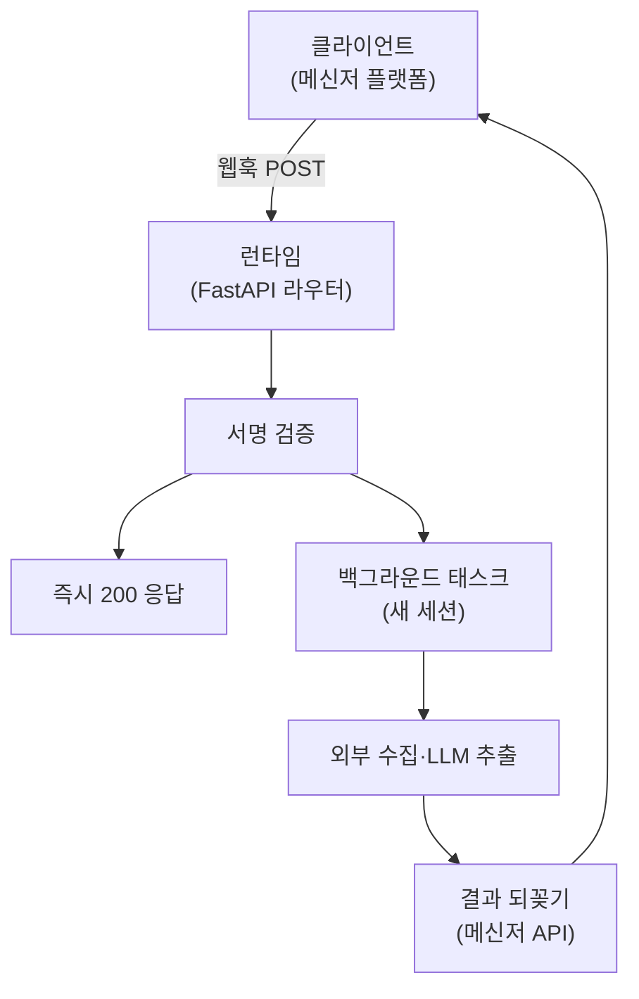

## 왜 이 흐름이 에이전트와 닮았는가

외부에서 요청을 받아 무거운 처리를 하고 결과를 돌려주는 흐름은, 요즘 에이전트 런타임의 요청 흐름과 모양이 같다.

```text
클라이언트 → 런타임 → (도구 호출) → 비동기 처리 → 결과 되꽂기
```

에이전트에서는 "런타임이 MCP로 도구를 부르고, 긴 작업 결과를 SSE로 흘려보낸다"로 나타난다. 개인 프로젝트(인스타 DM으로 릴스를 받아 맛집으로 적재)에서는 "런타임이 외부 API로 수집·추출하고, 결과를 메신저 API로 되꽂는다"로 나타난다. 전송 방식은 달라도 **골격은 동일하다.** 그 골격을 설계하면서 걸린 지점들을 정리한다.

---

## 전체 흐름



핵심은 **수신 응답과 실제 처리를 분리**한 것이다. 왜 분리해야 했는지부터가 설계의 출발점이었다.

---

## 1. 동기로 처리하면 안 되는 이유

메신저 플랫폼 웹훅은 보통 **20초 안에 200을 요구**한다. 그 안에 응답하지 않으면 플랫폼이 재전송하거나 구독을 끊는다.

그런데 내 처리는 외부 수집 + LLM 추출이라 10~20초를 쉽게 넘긴다. 동기로 처리하면 타임아웃에 걸린다.

그래서 라우터는 **검증만 하고 즉시 200을 주고, 무거운 일은 백그라운드로 넘긴다.**

```python
@router.post("/webhook")
async def receive_webhook(request: Request, background_tasks: BackgroundTasks):
    """DM 이벤트 수신. 서명 검증 후 처리를 백그라운드로 넘기고 즉시 200."""
    body = await request.body()
    _verify_signature(body, request.headers.get("x-hub-signature-256", ""))

    payload = json.loads(body or b"{}")
    background_tasks.add_task(process_webhook_task, payload)
    return {"ok": True}
```

"수신 확인"과 "실제 처리"는 다른 책임이다. 수신은 빠르게 끝내 재전송을 막고, 처리는 시간을 들여 제대로 한다.

---

## 2. 세션은 요청보다 오래 살지 않는다

여기서 처음 밟은 함정. 백그라운드 태스크 안에서 요청 때 쓰던 DB 세션을 그대로 쓰면 깨진다. **요청-스코프 세션은 응답이 나가는 순간 닫히기** 때문이다. 백그라운드 태스크는 그 응답 이후에 돈다.

그래서 백그라운드 진입점은 **새 세션을 직접 연다.**

```python
def process_webhook_task(payload: dict) -> None:
    """백그라운드 태스크 진입점. 요청 세션은 응답 후 닫히므로 새 세션을 연다."""
    if SessionLocal is None:
        logger.warning("[inbox] DATABASE_URL 미설정 — DM 처리를 건너뛴다")
        return
    db = SessionLocal()
    try:
        InboxService(db).handle_dm(payload)
    finally:
        db.close()
```

세션 소유권도 명확히 그었다. 서비스 객체는 세션을 **받아서 쓰기만** 하고(`InboxService(db)`), 열고 닫는 건 진입점이 책임진다. 단건 처리를 재사용하는 `ingest_one_reel`도 "세션은 호출자가 소유하므로 여기서 열지 않고 인자로 받는다"는 규칙을 따른다. 누가 세션을 소유하는지가 흐릿하면 "이미 닫힌 세션에 접근"이나 "커밋 안 된 트랜잭션"이 생긴다.

이건 에이전트의 세션 관리와 같은 문제다. 요청 수명, 작업 수명, 연결 수명이 **서로 다른 시계**로 돌기 때문에, 어느 자원이 어느 시계를 따르는지 명시해야 한다.

---

## 3. 한 건이 실패해도 배치는 계속

웹훅 payload 하나에 DM이 여러 개 올 수 있다. 하나가 실패했다고 나머지를 버리면 안 된다. 각 건을 독립 트랜잭션으로 처리하고, 실패는 롤백 후 로깅만 하고 넘어간다.

```python
def handle_dm(self, payload: dict) -> None:
    """웹훅 payload의 DM들을 처리한다. 한 건이 실패해도 배치는 계속한다."""
    for message in parse_webhook(payload):
        try:
            self.process_message(message, payload)
        except Exception:
            self.db.rollback()
            logger.exception("[inbox] DM 처리 실패 igsid=%s", message.igsid)
```

그리고 실패하더라도 **원본 payload는 먼저 저장**한다. 수집·추출이 터져도 입력 자체는 남겨 재처리·학습에 쓴다. 비동기 처리는 눈에 안 보이는 곳에서 실패하므로, 원본 보존과 로깅이 유일한 디버깅 수단이다.

---

## 4. 결과 되꽂기: 동기 응답이 아니라 콜백

처리를 비동기로 뺐으니, 결과는 원래 요청의 응답으로 못 돌려준다. 그 응답은 이미 `{"ok": True}`로 나갔다. 그래서 **별도 채널로 결과를 되꽂는다.**

```python
def _push_result(subscriber_id: str, result: dict) -> None:
    """추출 결과를 커스텀필드로 심고 회신 플로우를 트리거한다."""
    saved = result.get("status") == "extracted"
    places = ", ".join(result.get("place_names") or [])
    manychat_client.set_field(subscriber_id, "cuf_status", "saved" if saved else "not_found")
    manychat_client.set_field(subscriber_id, "cuf_last_place", places)
    manychat_client.trigger_flow(subscriber_id)
```

이게 에이전트 요청 흐름에서 SSE가 놓인 자리와 같다. 결과를 "열린 연결로 스트리밍"하든(SSE), "플랫폼 API로 되꽂"든, **요청과 응답이 분리된 비동기 세계에서 결과를 어떻게 다시 사용자에게 연결하느냐**의 문제다. 내 프로젝트는 플랫폼이 스트리밍 연결을 안 열어주니 콜백 방식을 택했을 뿐이다.

작업 성격에 따라 동기/비동기도 갈랐다. 매직링크 발급처럼 즉시 끝나는 건 동기로 바로 응답하고, 수집·추출처럼 긴 건만 비동기로 뺐다. **모든 걸 비동기로 만들 필요는 없다.** 짧은 건 동기가 더 단순하다.

---

## 5. 입구는 반드시 검증한다

웹훅은 인터넷에 열린 엔드포인트다. 검증 없이 열면 누구나 가짜 이벤트를 주입할 수 있다. 서명을 앱 시크릿으로 검증한다.

```python
def _verify_signature(body: bytes, header: str) -> None:
    """X-Hub-Signature-256을 앱 시크릿으로 검증한다. 검증 없이 열면 가짜 이벤트 주입 가능."""
    expected = "sha256=" + hmac.new(
        META_APP_SECRET.encode(), body, hashlib.sha256
    ).hexdigest()
    if not hmac.compare_digest(expected, header):
        raise ForbiddenError
```

`hmac.compare_digest`를 쓴 건 타이밍 공격을 피하려는 것이다. 일반 문자열 비교(`==`)는 몇 글자가 맞는지 응답 시간으로 샐 수 있다. 에이전트 런타임도 외부에서 도구 호출이나 콜백을 받는 입구가 있다면 같은 검증이 필요하다. **런타임의 입구는 전부 신뢰 경계다.**

---

## reelmap이 못 덮는 부분

정직하게 적자면, 이 프로젝트는 에이전트 요청 흐름의 일부만 구현한다.

- **비동기 / 세션 / 콜백 / 입구 검증** — 실제로 구현했다.
- **MCP** — 쓰지 않는다. 외부 호출을 직접 클라이언트 코드로 한다. MCP는 "런타임이 표준 프로토콜로 도구를 부르는" 자리에 들어가는데, 이 프로젝트는 거기까지 추상화하지 않았다.
- **SSE** — 쓰지 않는다. 스트리밍 연결 대신 플랫폼 API 콜백으로 결과를 되꽂는다.

그래도 "요청 수신과 처리를 분리하고, 각 자원의 수명을 명시하고, 입구를 검증하고, 결과를 별도 채널로 연결한다"는 골격은 전송 방식과 무관하게 동일하다.

---

## 느낀 점

### 수신과 처리는 다른 책임이다
20초 타임아웃 같은 제약은 "빠른 수신 확인"과 "느린 실제 처리"를 강제로 분리하게 만든다. 이 분리는 제약이 없어도 좋은 설계다. 입구가 가벼우면 재전송·폭주에 강해진다.

### 비동기의 핵심 난이도는 자원 수명이다
요청 수명, 작업 수명, 연결 수명이 서로 다른 시계로 돈다. DB 세션을 누가 소유하고 언제 닫는지를 명시하지 않으면, 비동기 경계에서 조용히 깨진다.

### 비동기면 결과를 되돌릴 채널이 따로 필요하다
요청 응답으로 결과를 못 주니, SSE든 콜백이든 별도 경로가 있어야 한다. 전송 방식은 플랫폼이 뭘 지원하느냐의 문제고, 설계의 본질은 "분리된 결과를 사용자에게 다시 연결"하는 것이다.

### 런타임의 입구는 전부 신뢰 경계다
외부에서 들어오는 모든 엔드포인트는 서명·토큰으로 검증해야 한다. 비교는 상수 시간으로 한다. 이건 웹훅이든 에이전트 콜백이든 동일하다.
