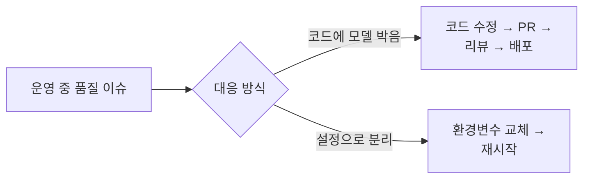
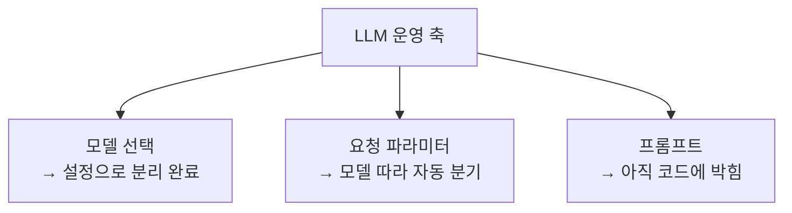

## 배경

예전에 한 핀테크 회사에서 신용평가 모델을 운영하면서 배운 원칙이 하나 있다. **모델을 바꾸는 일이 코드 배포를 요구하면 운영이 느려진다.** 평가 로직의 가중치나 임계값을 바꾸려고 매번 배포 파이프라인을 태우면, 바꿀 수 있어도 안 바꾸게 된다. 그래서 자주 바뀌는 축은 코드가 아니라 설정으로 뺀다.

LLM도 같다. 어떤 모델을 쓸지, 어떤 파라미터로 부를지는 **자주 바뀌는 축**이다. 품질이 아쉬우면 상위 모델로 올리고, 비용이 부담되면 경량 모델로 내린다. 이걸 코드에 박아두면 그때마다 배포해야 한다.

개인 프로젝트(릴스 캡션에서 맛집 추출)에서 이 원칙을 작게 적용하면서, "모델을 설정으로 뺀다"가 실제로 뭘 요구하는지 정리한다.

---

## 바꾸는 축을 설정으로 뺀다

추출기의 모델은 환경변수 하나로 결정된다.

```python
MODEL = os.getenv("REELMAP_EXTRACT_MODEL", "claude-haiku-4-5")
```

기본은 경량 모델(비용 때문에). 특정 크리에이터의 산문 캡션이 어려워 품질이 아쉬우면, 배포 없이 환경변수만 바꿔 상위 모델로 올린다.



핵심은 "무엇을 설정으로 빼느냐"의 판단이다. 전부 설정으로 빼면 설정이 또 하나의 복잡한 코드가 된다. **자주 바뀌고, 코드 로직과 무관하게 바뀌는 축만** 뺀다. 모델 선택이 딱 그렇다.

---

## 함정: 설정만 바꾼다고 끝나지 않는다

여기서 처음엔 몰랐던 걸 밟았다. 모델 ID만 환경변수로 빼면 될 줄 알았는데, **모델 세대에 따라 받아들이는 요청 파라미터가 다르다.**

경량 모델은 일부 고급 파라미터(adaptive thinking, effort)를 아예 거부한다. 상위 모델용 요청을 그대로 경량 모델에 보내면 400 에러가 난다. 즉 "모델을 바꾼다"는 "요청 모양도 함께 바꾼다"를 포함한다.

그래서 모델에 따라 파라미터가 자동으로 갈라지게 했다.

```python
MODEL = os.getenv("REELMAP_EXTRACT_MODEL", "claude-haiku-4-5")

# 경량 모델은 adaptive thinking / effort를 받지 않는다 (400).
_MODERN = not MODEL.startswith(("claude-haiku-4-5", "claude-sonnet-4-5"))

params = {
    "model": MODEL,
    "max_tokens": 2048,
    "system": SYSTEM,
    "output_config": {"format": {"type": "json_schema", "schema": SCHEMA}},
    "messages": [...],
}
if _MODERN:
    params["thinking"] = {"type": "adaptive"}
    params["output_config"]["effort"] = "low"
```

`_MODERN` 플래그가 세대 차이를 흡수한다. 설정 한 줄로 모델을 바꾸려면, 그 설정이 의미하는 **부수 효과를 코드가 알아서 처리**해줘야 한다. 그래야 운영자가 "이 모델엔 어떤 파라미터가 되더라?"를 외우지 않아도 된다.

신용평가 모델에서도 같았다. "모델 버전 교체"는 버전 번호만 바꾸는 게 아니라, 그 버전이 요구하는 입력 피처 셋·전처리 규칙까지 함께 따라가야 했다. **설정의 한 값이 바뀌면 그에 딸린 것들이 자동으로 맞춰져야** 진짜 "설정 한 줄 교체"가 된다.

---

## 설정은 한곳에, 비밀은 분리

프로젝트의 모든 외부 의존(DB, 인증, 외부 API 키, 웹훅 시크릿)은 한 모듈에 모아 환경변수로 읽는다. 코드 곳곳에서 `os.getenv`를 부르지 않는다.

```python
# core/config.py — 설정 단일 지점
DATABASE_URL = os.getenv("DATABASE_URL", "")
APIFY_API_KEY = os.getenv("APIFY_API_KEY", "")
MAGIC_LINK_TTL_MIN = int(os.getenv("MAGIC_LINK_TTL_MIN", "15"))
MODEL = os.getenv("REELMAP_EXTRACT_MODEL", "claude-haiku-4-5")
```

여기엔 안전 규칙도 같이 담긴다. 예컨대 서비스 역할 키(RLS를 우회하는 관리자 키)는 "절대 프론트에 노출하지 않는다 — 서버 전용"이라고 주석으로 못 박고, CORS는 `allow_origins=["*"]` + credentials 조합을 금지한다. 설정을 한곳에 모으면 **이런 운영 규칙을 설정 옆에 같이 적을 수 있다.** 흩어져 있으면 규칙도 흩어진다.

금융 쪽 경험에서 가져온 습관이다. 비밀 값과 일반 설정을 섞지 않고, 각 값이 왜 그렇게 설정돼야 하는지를 설정 지점에 남긴다.

---

## 아직 설정으로 못 뺀 것: 프롬프트

정직하게 적으면, 이 주제의 절반만 했다. **모델은 설정으로 뺐지만, 프롬프트는 아직 코드 안에 있다.** 시스템 프롬프트가 소스 상수(`SYSTEM = """..."""`)로 박혀 있어서, 추출 규칙을 바꾸려면 여전히 코드를 고치고 배포해야 한다.



프롬프트까지 설정으로 빼려면 버전 관리, 롤백, 그리고 [프롬프트 변경을 검증할 평가 체계](/posts/정답셋이-없을-때-추출기를-어떻게-신뢰하는가/)가 함께 필요하다. 프롬프트는 모델보다 품질 영향이 크고 되돌리기 어려워서, 평가 없이 설정으로만 빼면 오히려 위험하다. 그래서 지금은 의도적으로 코드에 두고 있다. "설정으로 뺄 수 있다"와 "설정으로 빼도 안전하다"는 다른 질문이다.

---

## 느낀 점

### 자주 바뀌는 축만 설정으로 뺀다
전부 설정화하면 설정이 또 다른 코드가 된다. 코드 로직과 독립적으로, 운영 중 자주 바뀌는 축(모델 선택)만 빼는 게 실익이 크다. 판단 기준은 "이걸 바꾸는 데 배포가 필요하면 아까운가"이다.

### 설정 한 값은 딸린 부수효과까지 책임져야 한다
모델을 바꾸면 요청 파라미터도 바뀌어야 한다. 그 분기를 코드가 흡수하지 않으면 "설정 교체"가 "설정 교체 + 코드 수정"이 된다. 설정의 값 하나가 바뀔 때 따라붙는 것들을 코드가 자동으로 맞춰야 진짜 무배포 교체다.

### 설정을 한곳에 모으면 운영 규칙도 모인다
값을 한 지점에 모으면, 왜 그 값이어야 하는지(비밀 분리, CORS 금지 조합)를 값 옆에 적을 수 있다. 설정이 흩어지면 규칙도 흩어지고, 누군가 위험한 조합을 다시 만든다.

### "뺄 수 있다"와 "빼도 안전하다"는 다르다
프롬프트는 기술적으로 설정화할 수 있지만, 평가 체계 없이 빼면 품질 회귀를 운영 중에 모르고 넘긴다. 무배포로 바꿀 수 있게 만드는 것과, 바꿔도 되는 안전망을 갖추는 것은 별개의 작업이다.
