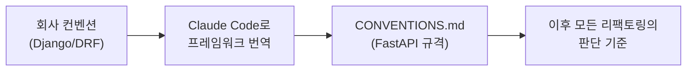
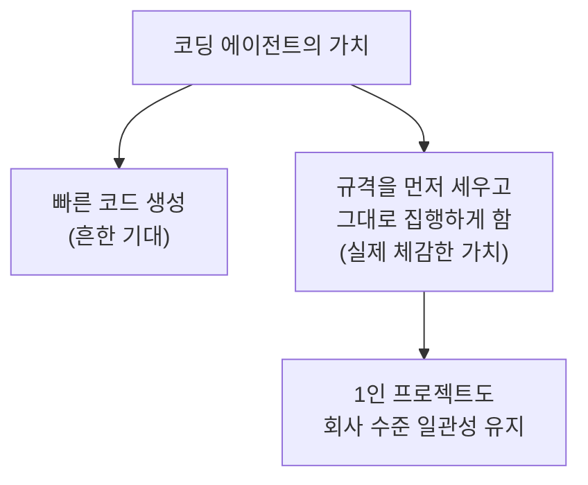

## 이 글의 각도

[Claude Code를 일상 워크플로우에 통합한 1년의 기록](/posts/claude-code를-일상-워크플로우에-통합한-1년의-기록/)에서는 "어디에 쓰면 효과적인가"를 정리했고, [1인 자동화를 팀 표준으로](/posts/1인-자동화를-팀-표준으로-skill을-플러그인으로/)에서는 그걸 팀 도구로 승격한 이야기를 했다.

이 글은 반대 방향이다. **회사에서 익힌 컨벤션을, Claude Code를 써서 개인 프로젝트에 역이식한** 구체적 사례다. 혼자 하는 사이드 프로젝트일수록 규격이 느슨해지기 쉬운데, 코딩 에이전트를 쓰면 "규격을 먼저 세우고 그 규격대로 코드를 맞추는" 순서를 혼자서도 유지할 수 있었다.

---

## 문제: 혼자 하면 규격이 무너진다

개인 프로젝트(인스타 릴스 → 맛집 지도)는 FastAPI로 빠르게 짜다 보니 코드가 제각각이었다. 예외는 `HTTPException`을 그때그때 던지고, 요청 모델 이름도 규칙이 없고, 라우터 하나에 모든 게 섞여 있었다.

회사(한 핀테크 회사)에서는 Django/DRF 기반으로 꽤 엄격한 컨벤션 아래 일했다. 예외 응답 형식 통일, 입출력 모델 네이밍, 도메인 경계 분리 같은 것들. 그 감각을 개인 프로젝트에도 가져오고 싶었지만, 프레임워크가 달라서(Django → FastAPI) 그대로 복사할 수는 없었다.

---

## 1단계: 규격 문서를 먼저 쓴다 (코드 말고)

바로 코드를 고치지 않았다. Claude Code와 함께 **규격 문서부터** 썼다. 회사의 Django/DRF 규칙을 FastAPI 맥락으로 번역한 `CONVENTIONS.md`다.

```text
- 예외 응답 envelope 통일: {error_code, message}
- 요청/응답 모델: XxxInput / XxxOutput
- 도메인 예외: XxxError (타입 예외 + 전역 핸들러)
- URL: kebab-case
- 구조: 도메인 모듈러 (router / service / schemas / exceptions)
```



이 순서가 핵심이다. 규격을 먼저 문장으로 고정하면, 이후 에이전트에게 작업을 시킬 때 "이 규격에 맞춰"라고 한 줄만 붙이면 된다. 규격 없이 "깔끔하게 리팩토링해줘"라고 하면 에이전트가 매번 다른 스타일을 낸다. **판단 기준을 코드 바깥 문서에 두는 것**이 일관성의 전제였다.

---

## 2단계: 규격대로 반복 리팩토링을 위임한다

규격이 서자, 그걸 기준으로 한 **반복적·기계적 리팩토링**이 Claude Code가 가장 잘하는 종류의 일이 됐다.

가장 큰 작업은 예외 처리 통일이었다. 코드 곳곳에 흩어진 `HTTPException` 37곳을, 타입 예외 + 전역 핸들러 구조로 바꿨다.

```python
# before — 라우터마다 제각각
raise HTTPException(status_code=404, detail="장소를 찾을 수 없습니다")

# after — 타입 예외를 던지면 전역 핸들러가 envelope로 변환
raise PlaceNotFoundError
# → 응답: {"error_code": "place_not_found", "message": "..."}
```

37곳을 손으로 바꾸면 지루하고, 지루하면 빠뜨린다. 규격이 명확한 반복 치환은 에이전트에게 맡기고, 나는 "핸들러 설계가 규격과 맞는가"만 검토했다. [예전 글](/posts/claude-code를-일상-워크플로우에-통합한-1년의-기록/)에서 적은 "판단은 사람이, 실행은 AI가"가 그대로 적용됐다 — 규격(판단)은 내가 정하고, 치환(실행)은 에이전트가 했다.

---

## 3단계: 표준 예제를 하나 만들어 둔다

도메인 모듈러 구조로 가면서, 모든 도메인을 한 번에 바꾸지 않았다. 대신 **하나를 표준 예제로** 완성했다. `saved_places` 도메인을 `router / service / schemas / exceptions`로 쪼개 "이게 이 프로젝트의 도메인 슬라이스 표준"으로 삼았다.

```text
domains/saved_places/
  router.py      # HTTP 경계
  service.py     # 비즈니스 로직
  schemas.py     # 입출력 모델
  exceptions.py  # 도메인 예외
```

이후 새 도메인(인박스, 메신저 어댑터)을 만들 때는 "saved_places와 같은 구조로"라고만 하면 됐다. **표준 예제 하나가 규격 문서보다 강한 지시**가 된다. 문서는 추상적이지만 예제는 구체적이라, 에이전트도 사람도 덜 헤맨다.

---

## 왜 이게 이력서에 쓸 만한 경험인가

이 경험을 이력서 첫 블록에 둔 이유가 있다. 코딩 에이전트의 가치는 "코드를 빨리 짜준다"가 아니라, **혼자서는 유지하기 어려운 엔지니어링 규율을 유지하게 해준다**는 데 있다고 보기 때문이다.



규격 문서를 쓰고, 그 규격으로 반복 리팩토링을 집행하고, 표준 예제로 이후 작업을 수렴시키는 것 — 이건 원래 팀에 테크리드가 있어야 유지되는 규율이다. 코딩 에이전트는 그 규율의 **집행 비용을 낮춰서**, 혼자서도 "규격 먼저" 순서를 포기하지 않게 해줬다. 회사에서 배운 걸 개인 프로젝트에 역수출하고, 그게 다시 회사 일의 감각을 벼리는 순환이 됐다.

---

## 느낀 점

### 규격을 코드 바깥 문서에 고정하면 에이전트가 일관돼진다
"깔끔하게 해줘"는 매번 다른 결과를 낸다. 규격을 문장으로 먼저 박아두고 "이 규격대로"라고 지시하면, 반복 작업의 결과가 일관된다. 일관성은 에이전트의 능력이 아니라 내가 준 기준에서 나온다.

### 반복·기계적 치환이야말로 위임의 적지
37곳 예외 치환처럼 규격이 명확하고 양이 많은 일은, 사람이 하면 빠뜨리고 에이전트가 하면 균일하다. 설계는 사람이, 치환은 에이전트가 맡는 분업이 가장 잘 맞았다.

### 표준 예제 하나가 문서보다 강하다
추상적 규격 문서보다, 완성된 예제 디렉터리 하나가 더 분명한 지시가 된다. 이후 모든 작업을 "이것과 같은 구조로"에 수렴시키면 규격이 저절로 전파된다.

### 에이전트는 규율의 집행 비용을 낮춘다
코딩 에이전트의 진짜 쓸모는 생성 속도보다, 혼자서는 지키기 힘든 "규격 먼저" 순서를 감당 가능하게 만든다는 데 있었다. 1인 프로젝트를 팀 수준 규율로 끌어올린 것이 가장 큰 수확이다.
